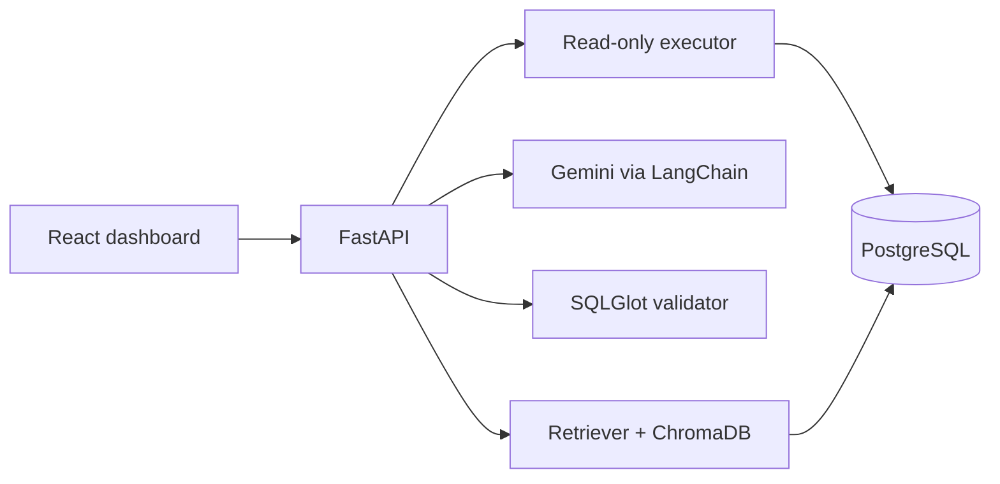

# QueryMind AI

Ask questions about a PostgreSQL database in plain English. QueryMind retrieves only the relevant parts of the schema, has an LLM write a SQL query, validates it, and runs it read-only when you click Run.

Stack: FastAPI, LangChain, Gemini, ChromaDB, sentence-transformers (MiniLM), SQLGlot, SQLAlchemy, PostgreSQL, React, Vite, TypeScript, Tailwind CSS, Recharts.

## Contents

1. [Overview](#overview)
2. [Features](#features)
3. [Architecture](#architecture)
4. [How a question is answered](#how-a-question-is-answered)
5. [Demo database](#demo-database)
6. [Quick start](#quick-start)
7. [Configuration](#configuration)
8. [Using the app](#using-the-app)
9. [API](#api)
10. [Safety model](#safety-model)
11. [Evaluation](#evaluation)
12. [Testing](#testing)
13. [Repository layout](#repository-layout)
14. [Design decisions](#design-decisions)
15. [Limitations](#limitations)
16. [Troubleshooting](#troubleshooting)
17. [Documentation](#documentation)

## Overview

Sending a whole database schema to an LLM does not scale and wastes tokens. QueryMind indexes the schema as small documents (tables, column groups, relationships) in a vector store, retrieves the few that match the question, adds the tables needed to join them, and gives the model only that context. Output is validated against the live schema before anything touches the data.

## Features

- Schema discovered at runtime with SQLAlchemy and `pg_catalog`. Nothing about the demo database is hardcoded.
- Semantic schema retrieval with foreign-key-aware expansion, and a UI panel that shows what was retrieved and why.
- Structured generation (JSON validated by Pydantic), a bounded repair loop, clarification questions and explicit assumptions.
- Follow-up questions ("now only for completed orders") using the last few turns of the conversation.
- AST-level SQL validation with SQLGlot, then read-only execution with timeout, plan-cost guard and row limit.
- Dashboard with SQL viewer, sortable and paginated results, CSV export, automatic chart selection, history, database explorer, index management, evaluation runner and settings.
- Golden dataset of 53 questions plus 28 adversarial statements, scored by code against real runs.

## Architecture



Full diagrams and component details: [docs/architecture.md](docs/architecture.md).

## How a question is answered

1. Follow-ups are rewritten into a standalone question using recent turns.
2. The question is embedded and the top-K schema documents are retrieved.
3. Tables are ranked, then joined tables are added via foreign keys (bridge tables first, then parents, then children).
4. The model receives the schema context and returns structured JSON: SQL, explanation, tables used, assumptions, confidence, or a clarification question.
5. The SQL is validated. If it fails, the errors go back to the model for a bounded number of repair attempts.
6. The UI shows the SQL, validation state and retrieval details. Nothing has run yet.
7. When you press Run query, the backend validates again and executes in a read-only transaction.

## Demo database

An e-commerce schema created from `database/init`:

| Table | Rows |
|---|---|
| customers | 520 |
| categories | 12 |
| products | 120 |
| orders | 1650 |
| order_items | 3386 |
| payments | 1727 |

The data is generated by a seeded script, so every install gets identical data. Tables have primary keys, foreign keys, CHECK constraints, indexes and column comments.

## Quick start

Docker (needs a Gemini API key from https://aistudio.google.com/apikey):

```bash
cp .env.example .env      # set GOOGLE_API_KEY and change the passwords
docker compose up --build
```

Open http://localhost:5173. API docs are at http://localhost:8000/docs.

Local development, tests and details: [docs/setup.md](docs/setup.md).

## Configuration

All settings are environment variables. The main ones:

| Variable | Default |
|---|---|
| `GOOGLE_API_KEY` | empty (required for generation) |
| `LLM_MODEL` | `gemini-3.8-flash` |
| `EMBEDDING_MODEL` | `sentence-transformers/all-MiniLM-L6-v2` |
| `RETRIEVAL_TOP_K` | `10` |
| `MAX_RESULT_ROWS` | `1000` |
| `STATEMENT_TIMEOUT_MS` | `15000` |

Full table: [docs/setup.md](docs/setup.md#configuration-reference). Keys are read from the environment only and never returned by the API.

## Using the app

Screenshots are not included yet. After running the app, capture these and place them in `docs/images/`:

| Page | File to add |
|---|---|
| New Query | `docs/images/new-query.png` |
| Retrieved schema context | `docs/images/retrieval.png` |
| Results and chart | `docs/images/results.png` |
| Query History | `docs/images/history.png` |
| Database Explorer | `docs/images/explorer.png` |
| Evaluation | `docs/images/evaluation.png` |

Pages:

- **New Query**: ask, review the SQL and assumptions, run, switch between table and chart, regenerate.
- **Query History**: past questions with SQL, status, timing and an Ask again button.
- **Database Explorer**: tables, columns, keys, indexes and comments read from PostgreSQL.
- **Schema Management**: index status, whether it matches the live schema, rebuild button.
- **Evaluation**: run the golden set, watch progress, inspect per-question and adversarial results.
- **Settings**: effective configuration and service health.

## API

Main routes: `POST /api/chat`, `POST /api/query/generate`, `POST /api/query/validate`, `POST /api/query/execute`, `GET /api/history`, `GET /api/schema`, `POST /api/schema/refresh`, `POST /api/evaluation/run`, `GET /health`. Request and response shapes, error codes and examples: [docs/api.md](docs/api.md).

## Safety model

Layers, each independent of the others:

1. Database role with SELECT only and read-only transactions by default.
2. SQLGlot AST validation: one statement, SELECT or set operations only, no DML/DDL/commands anywhere in the tree, function blocklist, no system catalogs, tables and columns must exist.
3. Read-only transaction, statement timeout, plan-cost refusal, server-side cursor with a row cap.
4. Generation and execution are separate steps. The model never runs anything.
5. The runtime container holds only the read-only credentials. Logs and errors are redacted.

Details and the reasoning behind each layer: [docs/architecture.md](docs/architecture.md#execution-safety).

## Evaluation

The dataset has 53 questions across 17 categories (simple selects through CTEs, ambiguous requests, missing tables and columns, out-of-scope and unsafe requests) and 28 adversarial SQL statements. Accuracy is computed by comparing result sets with reference SQL, not by comparing text.

Measured on the real pipeline: Gemini `gemini-3.6-flash` (thinking level low), MiniLM embeddings, the seeded PostgreSQL database, run on 15 Nov 2026. **46 of 53 questions are evaluated.** The 7 left are the `acceptance_examples` (e02 to e08), which only a free-tier daily quota stopped; they are scored on "valid and executes", so they cannot change the accuracy numbers.

| Metric | Value |
|---|---|
| Execution accuracy (result-set match, strict) | 94.1% (32 of 34) |
| Execution accuracy, extra columns allowed | 97.1% (33 of 34) |
| SQL validity | 100% of evaluated answerable questions |
| Execution success | 100% of evaluated answerable questions |
| Refusals correct (missing tables or columns, out of scope, unsafe) | 100% |
| Ambiguous questions handled (clarify or state assumptions) | 100% |
| Adversarial SQL rejected by the validator, and blocked end to end | 28 of 28 |
| Schema Recall@K (semantic) | 98.9% |
| Recall after foreign key expansion | 100.0% |
| Precision@K (semantic) | 38.3% (low by design, recall comes first) |
| Average generation time | 8.37 s |
| Exact SQL text match | 14.7% (informational: equivalent queries are written differently) |

The two strict misses are j02 (the answer added a `payment_id` column, which the lenient metric accepts) and x01 (a genuinely wrong result).

Honest limits of these numbers: one model, one dataset of 34 strictly scored questions, free-tier API (20 requests per day per model), and a few early answers were recorded before the model name was stored per answer. Results will differ between models and runs. Run it yourself with the Evaluation page or `python -m scripts.run_evaluation`. The Resume button lets a run continue over several days. Methodology: [docs/evaluation.md](docs/evaluation.md).

## Testing

```bash
cd backend && pip install -r requirements-dev.txt && pytest
cd frontend && npm install && npm test
```

Last run during development: backend 195 passed, 1 skipped (the test that downloads MiniLM); frontend 24 passed, plus a clean typecheck and production build. Backend tests run against a real disposable PostgreSQL with a scripted LLM, so they need no network and no API key. They cover units (parsing, documents, retrieval, serialization), the security matrix (injection, stacked statements, writes, catalogs, dangerous functions, timeouts, row limits) and API integration.

## Repository layout

```
backend/        FastAPI app, services, RAG, LLM, scripts, tests, golden dataset
frontend/       React + Vite + TypeScript dashboard
database/init/ schema, seed data and role creation for PostgreSQL
docs/           architecture, setup, API and evaluation docs
docker-compose.yml, .env.example, PROJECT_STATUS.md
```

## Design decisions

- **Chroma used directly with our own embeddings** instead of through a LangChain wrapper, so the index state, staleness check and scores stay under our control. LangChain is used where it adds value: prompts, structured output and the model abstraction.
- **Validation on the AST** because regex filters on SQL text are easy to bypass (comments, casing, nested CTEs). The executed SQL is the normalized output of the same parse.
- **Execution is a separate, explicit step.** Generating SQL has no side effects and never reads table data.
- **Read-only role plus application checks.** Neither is trusted alone.
- **History in SQLite** rather than in the target database, because the runtime role cannot write there and the app state should not depend on the database being queried.
- **Result-based evaluation.** Two different SQL strings can both be right, so exact-match is reported but not used as the accuracy metric.

## Limitations

- No authentication or multi-user isolation. Run it locally or behind your own access control.
- Gemini is the supported hosted model. An Ollama provider exists but was not tested.
- The full-pipeline numbers cover 46 of 53 questions with one model on a free API key. Results vary by model and run.
- Docker Compose was built and run on a MacBook with Docker 29 (backend, frontend and PostgreSQL started, database seeded, queries ran). Other platforms are untested.
- Very wide schemas are handled by column-group documents, but the retrieval limits (`RETRIEVAL_MAX_TABLES`, `RETRIEVAL_EXPAND_MAX`) may need tuning.
- Only PostgreSQL is supported.

## Troubleshooting

See [docs/setup.md](docs/setup.md#troubleshooting).

## Documentation

- [docs/architecture.md](docs/architecture.md)
- [docs/setup.md](docs/setup.md)
- [docs/api.md](docs/api.md)
- [docs/evaluation.md](docs/evaluation.md)
- [PROJECT_STATUS.md](PROJECT_STATUS.md)
