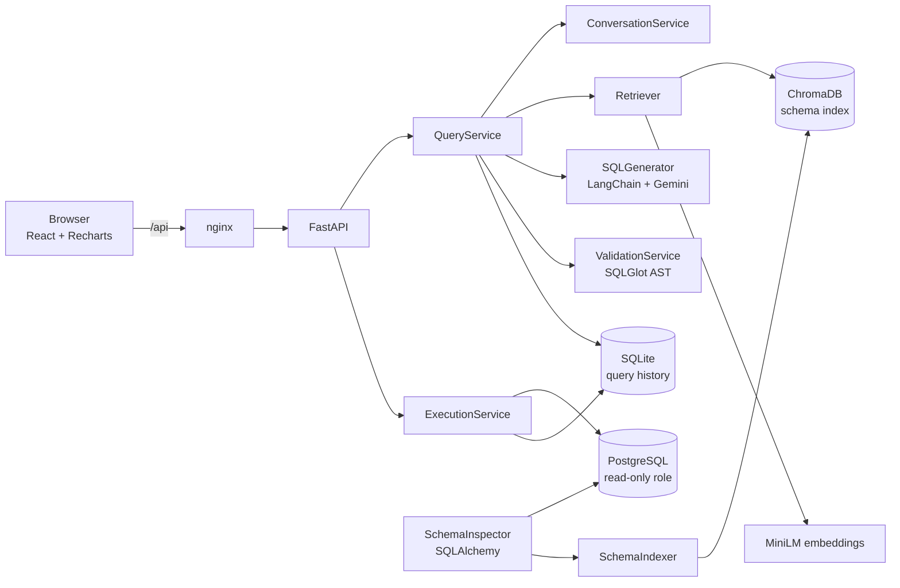
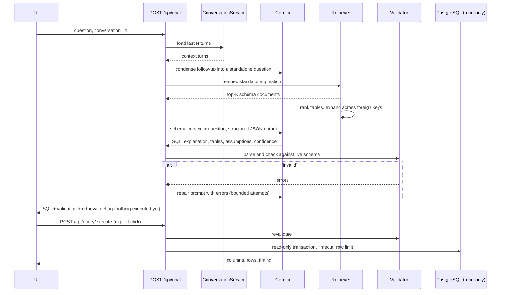

# Architecture

## System overview



## Request flow for one question



Generating SQL never touches the data tables. Execution only happens when the user presses Run query, and the backend revalidates the SQL itself instead of trusting the earlier result.

## Schema ingestion and retrieval

1. `SchemaInspector` uses SQLAlchemy reflection plus `pg_catalog` comments and CHECK constraints. Nothing about tables or columns is hardcoded.
2. `document_generator` turns the schema into retrieval documents: one per table, an extra columns document for wide tables, and one per foreign key relationship.
3. `SchemaIndexer` embeds the documents and stores them in a persistent Chroma collection (cosine distance). The index state (fingerprint, counts, timing) is saved next to it.
4. At startup the app compares the live schema fingerprint to the indexed one and rebuilds in the background when they differ. The Schema Management page and `POST /api/schema/refresh` do the same on demand.
5. `Retriever` embeds the question, takes the top-K documents, ranks tables by their best document score and keeps the best `RETRIEVAL_MAX_TABLES`.
6. Foreign key expansion adds missing tables so joins are possible: bridge tables between two selected tables first, then parents of selected tables, then children, capped by `RETRIEVAL_EXPAND_MAX`. Each table carries a `source` (`semantic` or `expanded`) and a reason, shown in the UI.

## SQL generation

- The prompt contains only the retrieved schema context (tables, columns, types, allowed values, join paths), the conversation window and rules for PostgreSQL.
- The model must answer with JSON matching the `SQLGeneration` Pydantic model: `status` (`ok`, `clarification_needed`, `cannot_answer`), `sql`, `explanation`, `tables_used`, `assumptions`, `confidence`, `clarification_question`.
- A tolerant parser accepts fenced or slightly malformed JSON, then validates with Pydantic.
- Generated tables must be a subset of the retrieved context. Anything else counts as a validation failure.
- On failure the generator re-prompts with the exact errors, up to `GENERATION_MAX_ATTEMPTS`. If it never produces valid SQL the API returns `invalid_sql` with the reasons instead of guessing.

## Validation (SQLGlot)

Checks run on the parsed AST, never on regex over text:

- exactly one statement
- root node is SELECT or a set operation over SELECTs
- no DML, DDL, `SELECT INTO`, locking clauses, `COPY`, `SET`, `CALL` or other command nodes anywhere in the tree (including inside CTEs and subqueries)
- function blocklist by prefix (`pg_`, `lo_`, `dblink`, `set_config`, `current_setting`, …) plus an allowlist for functions SQLGlot cannot type
- no system schemas (`pg_catalog`, `information_schema`) and no schemas outside `APP_SCHEMAS`
- every table exists in the live schema; every column resolves (SQLGlot `qualify`)
- join count and subquery depth limits

The normalized SQL is what gets executed, so what was validated is what runs.

## Execution safety

Defence in depth, in this order:

1. Dedicated Postgres role `querymind_ro`: SELECT only, `default_transaction_read_only=on`, no CREATE on `public`.
2. Backend validation (above).
3. `SET TRANSACTION READ ONLY` and `SET LOCAL statement_timeout`.
4. `EXPLAIN (FORMAT JSON)` first; plans above `MAX_PLAN_COST` are refused.
5. Server-side cursor with `fetchmany(limit + 1)` so the limit is enforced without loading everything and truncation is detectable.
6. Errors are translated to user-safe messages. A log filter redacts configured secrets.

The runtime container only receives the read-only `DATABASE_URL`. Admin credentials are used by the init scripts and Postgres entrypoint only.

## Storage

| Data | Where |
|---|---|
| Demo e-commerce data | PostgreSQL |
| Schema embeddings | ChromaDB persistent directory under `DATA_DIR` |
| Query history, conversations | SQLite file under `DATA_DIR` |
| Evaluation reports | JSON and Markdown under `DATA_DIR/reports` (or `backend/evaluation/reports`) |

## Backend layout

```
backend/app
  api/         deps (container), routes (thin)
  core/        logging, errors, security rules
  database/    connection, inspector, models, seed data, initialization
  rag/         document generator, embeddings, vector store, indexer, retriever
  llm/         provider registry, prompts, output parser, SQL generator
  services/    query, validation, execution, schema, history, conversation, evaluation
  schemas/     request and response models
  utils/       sql helpers, validators, serialization
```

Routes only parse input and call services. Services receive their collaborators through the `Container`, which is why tests can swap in a scripted LLM and a disposable database.

## Frontend layout

```
frontend/src
  components/  SqlViewer, ResultsTable, ChartPanel, RetrievalPanel, TurnCard, ui
  pages/       NewQuery, History, Explorer, Schema, Evaluation, Settings
  layouts/     AppLayout (sidebar)
  services/    api client (typed, one place for error mapping)
  hooks/       useAsync (loading, error, polling)
  utils/       chart recommendation, CSV export, SQL highlighter, formatting
  types/       API types mirroring the backend models
```

Every page reads from the backend. There is no mock data in the frontend.
